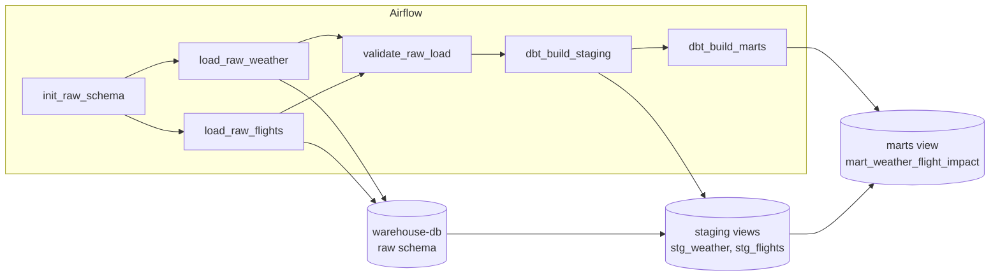

# Weather and flight ELT pipeline

A local, production-style Modern Data Stack project. Airflow loads mock weather and flight data into a Postgres warehouse, then dbt cleans it and builds an analytics view that shows how weather affects flight delays and cancellations.

No API keys, no cloud accounts. `docker compose up` is the only setup step.

## Architecture



| Layer | Tool | What it does |
| --- | --- | --- |
| Orchestration | Apache Airflow 2.10 (LocalExecutor) | Schedules the daily run, retries, ordering |
| Extract and load | Python (`src/extract.py`) | Generates one day of data, replaces that day's partition in `raw` |
| Warehouse | PostgreSQL 15 | Schemas `raw`, `staging`, `marts` |
| Transform | dbt Core 1.8 | Staging views, analytics mart, data tests |
| Infrastructure | Docker Compose | Two Postgres databases, Airflow init, webserver, scheduler |

Airflow's own metadata lives in a separate Postgres database (`airflow-db`) so business data and orchestration state never mix.

## Project layout

```
.
├── docker-compose.yml          Airflow + metadata DB + warehouse DB
├── Dockerfile                  Airflow image with dbt in an isolated virtualenv
├── requirements.txt            psycopg2, dbt-core, dbt-postgres
├── .env.example                Optional overrides for credentials and ports
├── warehouse/init/             SQL run once when the warehouse volume is created
├── src/
│   └── extract.py              Mock data generator + idempotent loader
├── dags/
│   └── weather_flight_etl.py   The Airflow DAG (@dag / @task)
└── dbt_project/
    ├── dbt_project.yml
    ├── profiles.yml            Reads WAREHOUSE_* environment variables
    ├── macros/generate_schema_name.sql
    ├── models/
    │   ├── staging/            _staging__sources.yml, _staging__models.yml,
    │   │                       stg_weather.sql, stg_flights.sql
    │   └── marts/              _marts__models.yml, mart_weather_flight_impact.sql
    └── tests/                  Singular data test
```

## Prerequisites

* Docker Desktop, or Docker Engine with the Compose v2 plugin (`docker compose version`)
* About 4 GB of free memory for Docker
* Ports `8080` (Airflow UI) and `5433` (warehouse) free on your machine

## 1. Start the stack

```bash
cp .env.example .env          # optional, every value has a working default
docker compose up --build -d
```

The first build takes a few minutes while the Airflow image installs dbt. Check progress:

```bash
docker compose ps
docker compose logs -f airflow-init     # wait for it to exit with code 0
```

When `airflow-webserver` and `airflow-scheduler` show `healthy`, open **http://localhost:8080** and sign in with `admin` / `admin` (change these in `.env`).

## 2. Run the DAG

The DAG `weather_flight_etl` is unpaused when it is created, so the scheduler starts a first run for the previous UTC day on its own within a minute or so. You can also run it yourself.

**From the UI:** open the DAG, press the play button, choose **Trigger DAG**.

**From the command line:**

```bash
docker compose exec airflow-scheduler airflow dags trigger weather_flight_etl
```

A manual run loads the **previous full UTC day** (the run's data interval). Watch the tasks turn green in the Grid view. The run order is:

1. `init_raw_schema`: creates schema, tables and indexes if missing
2. `load_raw_weather` and `load_raw_flights`: run in parallel
3. `validate_raw_load`: checks committed row counts match what was loaded
4. `dbt_build_staging`: builds the staging views and runs their tests
5. `dbt_build_marts`: builds the mart and runs its tests

### Load several days (backfill)

```bash
docker compose exec airflow-scheduler \
  airflow dags backfill weather_flight_etl --start-date 2026-10-01 --end-date 2026-10-07
```

Each day is its own partition, so backfilling a range twice gives the same result as once.

## 3. Check the results

Open a SQL shell on the warehouse:

```bash
docker compose exec warehouse-db psql -U warehouse -d warehouse
```

Or connect any SQL client to `localhost:5433`, database `warehouse`, user `warehouse`, password `warehouse`.

```sql
-- Row counts per layer
select 'raw.weather_observations' as t, count(*) from raw.weather_observations
union all select 'staging.stg_weather', count(*) from staging.stg_weather
union all select 'raw.flights', count(*) from raw.flights
union all select 'staging.stg_flights', count(*) from staging.stg_flights
union all select 'marts.mart_weather_flight_impact', count(*) from marts.mart_weather_flight_impact;

-- The point of the project: weather versus delays and cancellations
select
    weather_condition,
    sum(total_departures)                                              as departures,
    round(100.0 * sum(delayed_flights)   / sum(total_departures), 1)   as delay_pct,
    round(100.0 * sum(cancelled_flights) / sum(total_departures), 2)   as cancel_pct
from marts.mart_weather_flight_impact
group by 1
order by delay_pct desc;
```

`raw` holds slightly more rows than `staging` because the mock source emits a few duplicates on purpose. Thunderstorm, Snow and Fog should show clearly higher delay and cancellation rates than Clear.

## 4. Run dbt yourself

dbt is installed in the Airflow containers and reads the same project the DAG uses. The connection settings are already in the container environment.

```bash
# Build everything (models + tests, in dependency order)
docker compose exec airflow-scheduler dbt build

# Only staging, or one model and everything downstream of it
docker compose exec airflow-scheduler dbt build --select path:models/staging
docker compose exec airflow-scheduler dbt build --select stg_weather+

# Tests only
docker compose exec airflow-scheduler dbt test

# Are the raw tables fresh? (warns after 36 hours)
docker compose exec airflow-scheduler dbt source freshness
```

The project directory is mounted read-only, so dbt writes its artifacts to `/tmp` inside the container. That is already configured through environment variables.

### dbt from your own machine

Use a fresh virtual environment with Python 3.10 or newer:

```bash
python -m venv .venv && source .venv/bin/activate
pip install -r requirements.txt

cd dbt_project
dbt debug          # confirms the connection to localhost:5433
dbt build
dbt docs generate && dbt docs serve --port 8081     # browse lineage at http://localhost:8081
```

`profiles.yml` lives inside the project, and dbt checks the current directory first, so no extra flags are needed.

## 5. Run the extract script without Airflow

```bash
# From your machine (defaults target localhost:5433)
python -m src.extract --date 2026-10-07 --days 7

# Or inside the scheduler container
docker compose exec airflow-scheduler python -m src.extract --date 2026-10-07 --days 7
```

## Data model

**Raw** (`raw` schema, loaded by Python, kept as received)

| Table | Grain | Notes |
| --- | --- | --- |
| `weather_observations` | airport x hour | About 1% duplicate rows, about 2% missing visibility |
| `flights` | scheduled departure | Mixed-case airport codes, inconsistent status labels (`On Time`, `ON TIME`, `on-time`, `CANCELED`) |

**Staging** (`staging` schema, dbt views)

| Model | What changes |
| --- | --- |
| `stg_weather` | Deduplicated on `observation_id`, airport codes upper-cased, Celsius added, `is_low_visibility`, `is_high_wind`, `has_precipitation` flags |
| `stg_flights` | Deduplicated on `flight_id`, codes upper-cased, status normalised to `on_time` / `delayed` / `cancelled`, `is_delayed` (15+ minutes), `is_cancelled`, `route` |

**Mart** (`marts` schema)

`mart_weather_flight_impact`, one row per departure airport per UTC hour. Departure counts, cancelled, delayed and on-time flights, average and maximum delay, plus the weather at the origin that hour. Derived columns: `weather_severity` (`severe`, `moderate`, `mild`, `unknown`), `cancellation_rate`, `delay_rate`, `airport_baseline_delay_rate` and `delay_rate_vs_baseline`.

**Data tests**: `unique` and `not_null` keys, `accepted_values` on conditions, statuses and severity, plus a singular test that checks rates stay between 0 and 1. Because the DAG uses `dbt build`, a failed test stops the run before downstream models refresh.

## Design decisions

**Idempotency.** Re-running a day, clearing a task, or backfilling twice never duplicates data.

| Where | How |
| --- | --- |
| Raw tables, indexes, schemas | `CREATE ... IF NOT EXISTS` |
| Raw loads | One transaction per table: `DELETE` the day's partition, then `INSERT`. Readers never see a half-loaded day |
| Mock data | Seeded from the date, so a day always regenerates identically |
| dbt models | Views, rebuilt from scratch each run |
| Airflow | `max_active_runs=1`, each run works on exactly one data interval |

**dbt in its own virtualenv.** Airflow and dbt pin conflicting dependency versions. The Dockerfile installs dbt in `/home/airflow/dbt_venv`, and the DAG calls the `dbt` executable. No resolver conflicts, and either side can be upgraded independently.

**Real signal in the mock data.** Delay and cancellation probabilities depend on weather at the origin airport during the scheduled departure hour. The mart therefore shows a believable relationship, which makes the dashboards and queries worth looking at.

**Clean schema names.** `macros/generate_schema_name.sql` makes dbt use `staging` and `marts` exactly, instead of `analytics_staging`.

**Everything is UTC.** Hours in the weather and flight data line up without time zone arithmetic.

## Troubleshooting

| Symptom | Fix |
| --- | --- |
| Port 8080 or 5433 already in use | Stop the other service, or change `WAREHOUSE_HOST_PORT` in `.env`. For Airflow, edit the `8080:8080` mapping in `docker-compose.yml` |
| DAG missing in the UI | `docker compose exec airflow-scheduler airflow dags list-import-errors` |
| A task failed | Open the task in the Grid view and read its log. dbt test failures list the failing test and the compiled SQL path |
| `airflow-init` keeps failing | `docker compose logs airflow-init`. Most often the metadata database was not ready yet, run `docker compose up -d` again |
| Want a clean slate | `docker compose down -v` removes containers and both databases, then `docker compose up --build -d` |
| Changed `requirements.txt` or `Dockerfile` | `docker compose build` and `docker compose up -d` |

Stop the stack and keep your data with `docker compose down`.

## Where to go next

* Swap the mock generator for real sources such as Open-Meteo (weather) and OpenSky (flights). Only `src/extract.py` changes, because the raw tables are the contract.
* Make `mart_weather_flight_impact` incremental once volumes grow.
* Add dbt `unit_tests` and a CI job that runs `dbt build` against a throwaway Postgres.
* Connect Metabase or Superset to the `marts` schema.
